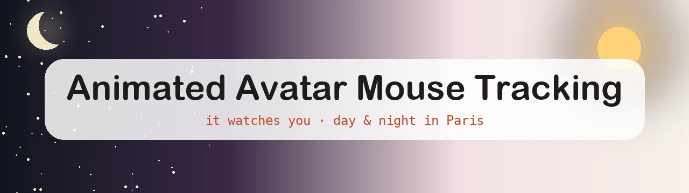

<div align="center">



<br>
<br>


<!-- Animated title, in the GitHub text colour of each theme -->
<a href="https://github.com/DenverCoder1/readme-typing-svg">
  <picture>
    <source media="(prefers-color-scheme: dark)" srcset="https://readme-typing-svg.demolab.com?font=Inter&weight=600&size=32&duration=3000&pause=1200&center=true&vCenter=true&width=640&height=50&lines=Animated+Avatar+Mouse+Tracking;It+watches+your+mouse;It+blinks%2C+gets+bored%2C+yawns;Day+and+night+in+Paris&color=F0F6FC">
    
  </picture>
</a>

**An "under construction" page that looks back at you.**
A 2D avatar follows your mouse with its eyes, blinks, gets bored, yawns…
and lives by the Paris sun.

<a href="https://emmanuelmaravilha.com/">
  
</a>

[](https://github.com/manufao/animated-avatar-mouse-tracking/actions/workflows/ci.yml)
[](https://github.com/manufao/animated-avatar-mouse-tracking/actions/workflows/security-scan.yml)
[](https://github.com/manufao/animated-avatar-mouse-tracking/actions/workflows/security-scan.yml)
[](#-tests)
[](https://github.com/manufao/animated-avatar-mouse-tracking/releases/latest)
<br>
[](https://developer.mozilla.org/docs/Web/JavaScript/Guide/Modules)
[](https://vite.dev/)
[](https://lightningcss.dev/)
[](package.json)
[](https://pnpm.io/)
<br>
[](https://prettier.io/)
[](https://eslint.org/)
[](https://www.typescriptlang.org/docs/handbook/type-checking-javascript-files.html)
[](https://www.conventionalcommits.org/)
[](LICENSE)
[](LICENSE-IMAGES)
<br>
[](outils/README.md)
[](https://docs.astral.sh/uv/)
[](https://docs.astral.sh/ruff/)
[](https://docs.pytest.org/)

### 🧰 Built with

<a href="https://skillicons.dev">
  
</a>

</div>

---

## 🎭 What it does

> **👉 See it in action on [emmanuelmaravilha.com](https://emmanuelmaravilha.com/)**: move your mouse, stay still for a while, click it… and come back at night to pull the light chain.

|                                  |                                                                                      |
| -------------------------------- | ------------------------------------------------------------------------------------ |
| 👀 **It watches you**            | Pupils and head follow the mouse, a finger, or the link that has the keyboard focus. |
| 😌 **It blinks**                 | At random, every 2.5 to 6.5 seconds, like a real one.                                |
| 😑 **It gets bored**             | Eight seconds without moving? The eyes drop, the face goes long.                     |
| 🥱 **It yawns**                  | After twenty seconds, then every now and then. Move, and it wakes up.                |
| 😄 **It reacts to a click**      | A little hop of joy.                                                                 |
| 🌅 **It lives on Paris time**    | Dawn, day, dusk, night: the colours follow the real Paris sun.                       |
| 💡 **It has a light bulb**       | At night, pull the chain to switch the light on. By day, it just swings.             |
| 🎉 **It celebrates**             | A paper crown for Epiphany, more accessories to come.                                |
| ♿ **It respects your settings** | With "reduce motion" on, the avatar stays a still picture.                           |

No runtime library: plain HTML, CSS and JavaScript, about 10 KB of JS once compressed.
The page itself is written in French, for its French-speaking visitors.

## 🚀 Getting started

Requirements: Node.js 22.12 or later, and [pnpm](https://pnpm.io/).

```bash
pnpm install
pnpm dev        # local server with hot reload
```

| Command                        | What it does                                      |
| ------------------------------ | ------------------------------------------------- |
| `pnpm build`                   | Production site in `dist/`                        |
| `pnpm preview`                 | Serves `dist/` locally to check the build         |
| `pnpm test`                    | Unit tests in watch mode                          |
| `pnpm test:ci`                 | Tests with coverage (100% required, file by file) |
| `pnpm test:types`              | Type check of the JavaScript (JSDoc + TypeScript) |
| `pnpm lint` / `pnpm lint:deps` | ESLint / dependency rules (dependency-cruiser)    |
| `pnpm format`                  | Prettier                                          |
| `pnpm test:tools`              | Ruff and pytest for the Python tools of `outils/` |

## 🗂️ Project structure

```
index.html
src/
  main.js                 entry point: starts the scene, then the avatar
  components/
    scene/                day/night mood, light bulb, visitor choice, special dates
    avatar/               gaze, mood, blinks, pointer tracking
  lib/                    pure functions: sun, calendar, gaze maths
  data/occasions.js       the special dates
  config/                 scene and avatar settings
  assets/css/             one CSS file per part, gathered by main.css
public/                   copied as is: images and .htaccess
outils/                   avatar layer builder, in Python (see outils/README.md)
docs/images/              README banners and logos
```

Dependencies go one way only: `components` use `lib`, `data` and `config`, never the other way round.

## 🎨 Bring your own avatar

The avatar is a stack of transparent layers on the same 720 × 960 canvas: the body, the blank head, the bored, happy and yawning faces, the closed eyelids, and one accessory per special date. The eyes are not in the pictures: they are CSS shapes behind the transparent eye holes of the head, which is why the pupils can move.

[`outils/build_layers.py`](outils/build_layers.py) builds these layers from seven pictures of the same character, one per expression, all with the same framing. It removes the white background, cuts the head from the body, and writes the eye and neck positions to `out/landmarks.json`, ready to copy into `src/assets/css/avatar.css`. The steps are in [outils/README.md](outils/README.md).

It is a one-off Python tool (numpy, SciPy, Pillow), not part of the site build. [uv](https://docs.astral.sh/uv/) installs its dependencies in an isolated environment:

```bash
uv run --project outils outils/build_layers.py
```

## 🧪 Tests

Every file in `src/` has its Vitest test (`*.test.js`), and the CI requires **100%** coverage of statements, branches, functions and lines, for each file. The sun calculation is checked against the real Paris sunrise and sunset times.

The Python tools have their own pytest suite, with 100% coverage of the mask helpers (`pnpm test:tools`).

## 🌍 Deployment (Apache shared hosting)

1. Download `site-vX.Y.Z.zip` from the [latest release](https://github.com/manufao/animated-avatar-mouse-tracking/releases/latest), or build it yourself with `pnpm build` (the site lands in `dist/`).
2. Upload **the content** of the zip, or of `dist/`, to the site root, over FTP for instance.
   `.htaccess` is a hidden file: make sure your FTP client uploads it.
3. Check the headers: `curl -sI https://emmanuelmaravilha.com/`

`.htaccess` sends every visit to `https://emmanuelmaravilha.com/`: to host the page elsewhere, replace that address in its redirect rule. HSTS starts short (`max-age=300`), to raise to one year once HTTPS is checked on the live site.

## 🏷️ Releases

Each release is listed in the [changelog](CHANGELOG.md). To publish one:

1. In a pull request, set the new `version` in `package.json` and add its section to `CHANGELOG.md`.
2. Once merged, tag `main` and push the tag:
   ```bash
   git switch main && git pull
   git tag v1.1.0 && git push origin v1.1.0
   ```
3. The release workflow checks the tag against `package.json`, runs the tests, builds the site and publishes the release with `site-v1.1.0.zip` and the changelog notes.

## 🛡️ Quality and security

- **Git hooks** (Husky): Gitleaks and lint-staged before each commit, commitlint on the message, and before each push the types, lint, dependency rules, tests and Python checks. Direct pushes to `main` are refused.
- **GitHub CI**: format, lint, dependencies, types, tests with coverage and build, Ruff and pytest for the Python tools, then Gitleaks, `pnpm audit`, Semgrep and OWASP ZAP.
- **Known advisory, no production impact**: `minimatch` < 11.0.1 ([GHSA-g3hv-75wg-m249](https://github.com/advisories/GHSA-g3hv-75wg-m249)), moderate. It only comes with the dev tooling: ESLint 10.14 and `eslint-plugin-import-x` 4.17 (both the latest releases) still ask for `minimatch` 10, and the import-x plugin breaks with `minimatch` 11. The flaw needs `optimizationLevel` 2 or more and an attacker-controlled glob; ESLint keeps the default level and only reads the globs of this repository's own config. Nothing from these packages ships to the site. To be removed once both packages accept `minimatch` 11.

## 📜 License

- **Code** (HTML, CSS, JavaScript, configuration, `outils/`): MIT license, see [LICENSE](LICENSE).
- **Images** (`public/img/` and `docs/images/`): all rights reserved, see [LICENSE-IMAGES](LICENSE-IMAGES).
  The avatar depicts the author: to reuse the code, replace the images with your own (720 × 960 pixels).

---

<div align="center">

Made with ☕ by [Emmanuel Maravilha](https://github.com/manufao) · [LinkedIn](https://fr.linkedin.com/in/emmanuel-maravilha-0a8b053b)

</div>
