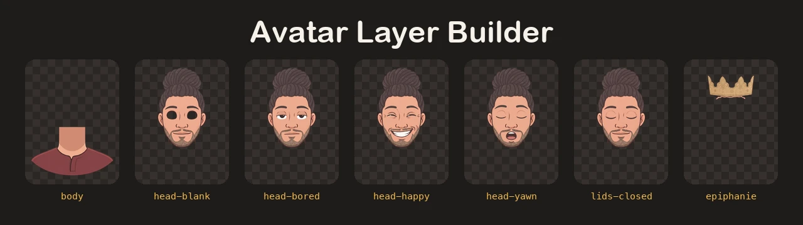
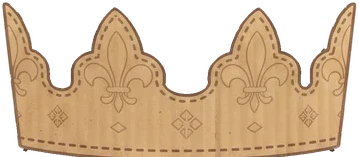

<div align="center">



<br>
<br>



# Avatar Layer Builder

**Seven drawings in, a whole animated avatar out.**
Cuts pictures of the same character into the aligned, transparent layers
that the page stacks and animates.

[](https://www.python.org/)
[](https://docs.astral.sh/uv/)
[](https://docs.astral.sh/ruff/)
[](https://docs.pytest.org/)
[](#-development)
<br>
[](https://numpy.org/)
[](https://scipy.org/)
[](https://python-pillow.org/)
[](#-outputs)
[](../LICENSE)

<a href="https://skillicons.dev">
  
</a>

</div>

---

## ✂️ What it does

| Step                          | How                                                                                                      |
| ----------------------------- | -------------------------------------------------------------------------------------------------------- |
| 🧼 **Removes the background** | Near-white areas touching the picture border become transparent; inner whites (eyes, teeth) stay.       |
| 🪶 **Softens the edges**      | Outline pixels next to a removed area get a partial alpha, and their colour is recovered as if over white. |
| 🔪 **Splits head and body**   | Finds the neck by its skin colour and cuts each column just under the chin.                              |
| 🦒 **Hides the seam**         | Extends the neck of the body upward, behind the head, so that a tilted head never shows a gap.          |
| 👁️ **Opens the eyes**         | Cuts the two eye whites out of the blank head: the page draws moving pupils behind these holes.         |
| 👑 **Cuts the accessories**   | Keeps the golden cardboard of the crown picture, holes filled and outline added.                        |
| 📐 **Measures the face**      | Writes the eye boxes and the head pivot to `landmarks.json`, in percent of the canvas.                   |

## 📥 Inputs

Seven JPG pictures in `outils/src/` (ignored by Git), **1792 × 2400 pixels**, all with exactly the same framing.
The script stops with a clear message if one is missing or has another size.

| File        | Expression                        | Gives                          |
| ----------- | --------------------------------- | ------------------------------ |
| `ref.jpg`   | reference, eyes open              | `body`, `avatar-static`        |
| `blank.jpg` | neutral face, plain white eyes    | `head-blank` and the eye holes |
| `closed.jpg` | eyes closed                       | `lids-closed`                  |
| `bored.jpg` | heavy eyelids                     | `head-bored`                   |
| `yawn.jpg` | yawning                           | `head-yawn`                    |
| `happy.jpg` | big smile                         | `head-happy`                   |
| `crown.jpg` | wearing the Epiphany paper crown  | `occasion-epiphanie`           |

## 🚀 Usage

Requirement: [uv](https://docs.astral.sh/uv/getting-started/installation/). It installs Python and the locked dependencies in an isolated environment: no `pip install` on the system Python.

```bash
uv run --project outils outils/build_layers.py
```

The command works from any folder. Then copy the layers of `outils/out/` to `public/img/` and [make their AVIF versions](#-avif-layers).

## 📤 Outputs

- `outils/out/*.webp`: the layers, 720 × 960 pixels with transparency.
- `outils/out/landmarks.json`: positions to report in `src/assets/css/avatar.css` when the framing changes.

Shape of the file, with the values behind the current CSS (rounded):

```json
{
  "eyes": [
    { "cx": 39.37, "cy": 44.75, "w": 10.1, "h": "…" },
    { "cx": 60.66, "cy": 44.75, "w": 10.1, "h": "…" }
  ],
  "pivot": { "x": 50.0, "y": 70.46 },
  "neck": { "left": "…", "right": "…" },
  "eye_w_px": 181.0
}
```

| Key                  | Goes to                                                     |
| -------------------- | ----------------------------------------------------------- |
| `eyes[].cx`, `cy`    | `left` and `top` of `.eye--left` and `.eye--right`         |
| `eyes[].w`           | `width` of `.eye`                                           |
| `pivot.y`            | `transform-origin` of `.avatar__head`                       |

## 🪶 AVIF layers

The page loads the six main avatar layers as AVIF and falls back to WebP for the browsers that cannot read it. [`build_avif.py`](build_avif.py) writes the `.avif` file next to each of the six layers of `public/img/` (quality 60, full colour resolution): **37% lighter** than the WebP, for 45 dB or more of fidelity. Run it again after copying new layers:

```bash
uv run --project outils outils/build_avif.py
```

The special-date accessories stay WebP: the page script picks their file from the list in `src/data/occasions.js`.

## 🖼️ Site icons

[`build_favicon.py`](build_favicon.py) crops the face of `public/img/avatar-static.webp` onto a round disc and writes `public/favicon.ico` (16, 32 and 48 pixels) and `public/apple-touch-icon.png` (180 pixels). Run it again whenever the avatar changes:

```bash
uv run --project outils outils/build_favicon.py
```

## 🎛️ Tuning

Every threshold is a named constant at the top of [`build_layers.py`](build_layers.py), measured on the 1792 × 2400 source pictures: the skin colour, the neck seed pixel, the split rows, the crown rows and colours. With another character or framing, adjust them there first.

## 🧑‍💻 Development

```
outils/
  build_layers.py     the pipeline: load, split, build each layer, measure
  build_avif.py       the AVIF version of the layers
  build_favicon.py    the site icons, from the static avatar
  masks.py            pure mask and matting helpers
  tests/              pytest suite
  pyproject.toml      dependencies, Ruff and pytest settings
  uv.lock             locked versions
```

```bash
cd outils
uv run ruff format .     # format
uv run ruff check .      # lint
uv run pytest            # tests, 100% coverage of masks.py required
```

From the repository root, `pnpm test:tools` runs all three. They also run in the pre-push hook and in the CI.
The pipeline itself is not unit tested: it needs the real source pictures, which stay private.

## 📜 License

The code is MIT licensed, see [LICENSE](../LICENSE). The pictures and the layers depict the author and are all rights reserved, see [LICENSE-IMAGES](../LICENSE-IMAGES).
